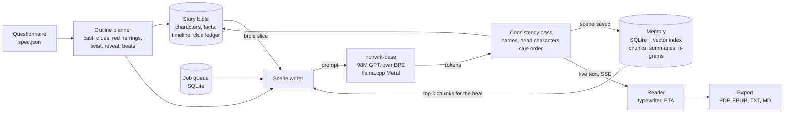

# Noirwrit

Noirwrit writes crime and noir novels, chapter by chapter, on your own laptop, with no network. It runs its own language model, trained from scratch on public domain detective and pulp fiction published in 1930 or earlier. There's no borrowed model and no API.

You answer a short questionnaire (or leave it blank), and Noirwrit plans the mystery: cast, clues, red herrings, twist and reveal. Then it writes the book scene by scene, typing each chapter out live in a local reader while it prefetches the next one. Finished books export to print-ready PDF, EPUB for Kindle, TXT and Markdown.

> "Now, it's up to you, Tom," said Corder, "but I'll see you through. You're wanted at the house, and you came out here to look after the other fellow."
>
> from a chapter written by `noirwrit-base` ([more samples](docs/samples/README.md))

## Quickstart (macOS)

```bash
brew install uv llama.cpp pango
git clone https://github.com/tejgokani/noirwrit && cd noirwrit
make setup        # Python 3.11 venv and dependencies
make model        # installs the trained model into ~/.noirwrit/models
make demo         # writes a short story and exports PDF, EPUB and Markdown
make run          # opens the app at http://127.0.0.1:8765
```

`llama.cpp` gives fast Metal generation; without it Noirwrit falls back to its own PyTorch runtime. `pango` is needed for PDF export. Optional: `make tools` installs epubcheck (it needs Java) so EPUBs are validated before you send them to a Kindle.

## How it works



- **Planner** (`noirwrit/planner`): turns the spec into a cast, three true clues, two red herrings, a midpoint twist and a reveal, spread across chapters as beats of about 500 words.
- **Story engine**: writes each beat from a prose lead-in, with the previous chapter's summary, retrieved memory chunks and a slice of the story bible in front. Every scene is saved as soon as it's written, so a crash loses at most one scene.
- **Consistency pass**: fixes misspelled character names and names borrowed from the training books, and regenerates a scene when a dead character speaks or a clue shows up before it's planted.
- **Memory** (`noirwrit/memory`): everything Noirwrit writes, and any notes or manuscripts you give it, is chunked (500 tokens, 50 overlap), embedded and searchable. That's how chapter 10 knows what happened in chapter 1 while the model's window stays at 2,048 tokens. A novelty check (embedding cosine plus 5-gram overlap) keeps new stories from repeating old ones, and names are never reused across stories.
- **Worker** (`noirwrit/worker.py`): a SQLite job queue that survives restarts, prefetches the next chapter, estimates time left from a rolling tokens-per-second average, and pauses when the Mac runs hot.
- **Model** (`noirwrit/model`): a decoder-only GPT written from scratch (RoPE, RMSNorm, SwiGLU, tied embeddings) in a Llama-compatible layout, so it exports straight to GGUF for llama.cpp. See the [model card](docs/MODEL_CARD.md).

## The app

The local web app has five screens:
- **New story:** the questionnaire. If a request looks like an earlier one, it shows which fields matched and offers to continue, vary or start fresh.
- **Reader:** chapter sidebar, live typing, progress and ETA, reader mode.
- **Library:** all your stories.
- **Memory:** what Noirwrit remembers about each story, plus your own context files.
- **Settings:** model, speed versus quality, thermal and memory limits, typing speed, export defaults.

Dark and light themes. Keyboard shortcuts: `j`/`k` next and previous chapter, `r` reader mode, `t` theme, `f` finish typing, `?` for the full list.

Exports work for one chapter or the whole book:
- **PDF:** A4, US Letter, A5 or 6 x 9 in, with a title page, table of contents, chapter openers, page numbers, running headers and embedded fonts.
- **EPUB 3:** cover, table of contents and metadata. It passes epubcheck.
- **TXT and Markdown.**

The Kindle helper saves the EPUB and explains the three ways to send it. Noirwrit never emails or uploads anything itself.

## Performance on a MacBook Air M3 (16 GB)

| | |
|---|---|
| Generation | 229 tokens/s (llama.cpp Q8_0) |
| A 3,000-word chapter | about 23 s |
| Memory while generating | 0.26 GB |
| ETA error | under 6% |
| Network calls at runtime | none (verified with the network blocked: `tools/offline_check.py`) |

Details: [docs/BENCH.md](docs/BENCH.md) and [docs/GATES.md](docs/GATES.md).

## Mac safety notes

The MacBook Air has no fan. Noirwrit treats it accordingly:
- Heavy local jobs go through `tools/guard.py`. It kills a job above 9 GB, kills on a swap storm to protect the SSD, pauses when thermal pressure is serious or critical, and rests 3 minutes after every 10 minutes of load. It counts GPU (Metal) memory, which plain RSS misses.
- The laptop only trains the 5M-parameter `tiny` model, for at most 10 minutes. Real training happens online.
- The generation worker checks the thermal state between scenes and pauses when the Mac is hot.
- Run long jobs on the charger, on a hard flat surface.

## Training your own

Everything is reproducible from public domain text:

```bash
python -m noirwrit.corpus.build              # Gutenberg download, PD checks, cleaning, dedupe
python -m noirwrit.tokenizer.train_tokenizer # 16k BPE and uint16 shards
make train-online                            # free Kaggle T4, about 10 hours, $0
```

See [docs/ONLINE_TRAINING.md](docs/ONLINE_TRAINING.md). The base model took 9.6 hours on Kaggle's free tier. A RunPod fallback has a hard $8 cap.

## Data and licenses

- **Code and weights:** MIT.
- **Training text:** 1,828 books from Project Gutenberg, all public domain in the US. Noirwrit adds a stricter rule: every title must be provably published in 1930 or earlier, through its authors' death dates, a well-established first publication year, a dated pulp issue, or its own dated front matter. Unsure means out. Every title and its basis is listed in [data/SOURCES.md](data/SOURCES.md).
- **Embedder:** the one pretrained component is the sentence embedder used for memory search (all-MiniLM-L6-v2, Apache-2.0), and only when installed. A built-in hashing embedder is the default and needs no download.

## Honest limits

- A 100M model writes convincing old-style detective prose in short stretches. It keeps a sentence and usually a paragraph together, but loses details over a page: a character found dead may be spoken to a paragraph later. Plot logic comes from the planner, the story bible and memory, not from the weights.
- Public domain data means a classic Doyle and Christie voice, with early hardboiled and pulp, not modern thriller pacing. Expect period spellings, and the attitudes of the period.
- "Learns" means it remembers and retrieves. It does not update its weights on the laptop.
- Optional later: fine-tuning on stories you rated, on a rented GPU, for about $2 to $5.

## Project files

- [PROGRESS.md](PROGRESS.md): phase status.
- [DECISIONS.md](DECISIONS.md): every design decision and why.
- [CONTRIBUTING.md](CONTRIBUTING.md): how to contribute.
